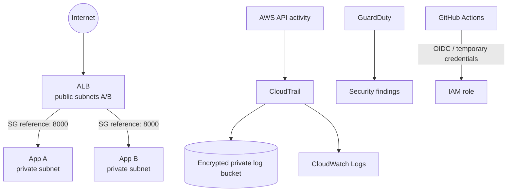

# ☁️ CloudSec-Lab

Secure AWS infrastructure engineered with Terraform and DevSecOps security controls.

CloudSec-Lab demonstrates how to design, provision, harden, monitor, and continuously validate a cloud environment using Infrastructure as Code.

## What This Project Demonstrates

- Secure AWS network architecture and private application workloads
- Infrastructure as Code with reusable Terraform modules
- IAM least privilege and GitHub-to-AWS OIDC authentication
- Cloud activity auditing with CloudTrail and threat detection with GuardDuty
- Automated IaC, secret, dependency, code, and container security scanning
- Cost-aware security engineering with optional NAT and compute

**Core technologies:** AWS · Terraform · IAM · VPC · EC2 · ALB · S3 · Docker ·
FastAPI · CloudTrail · CloudWatch · GuardDuty · GitHub Actions · Checkov · Trivy

> This project does not deploy automatically. AWS resources can be billable;
> inspect the plan and [cost guidance](docs/cost-estimation.md) first.

## Architecture



The backend has no public IP and no SSH ingress. Only the public ALB can reach
port 8000. NAT is disabled by default; private egress can use an explicitly
enabled NAT or production VPC endpoints. See [architecture decisions](docs/architecture.md).

## Security Architecture

| Area | Implementation | Threat reduced |
|---|---|---|
| Network | Two-AZ public/private segmentation and SG references | Direct backend attack |
| Identity | EC2 role, IMDSv2, branch-bound OIDC | Static-key theft and metadata abuse |
| Audit | Multi-region CloudTrail to S3 and CloudWatch | Repudiation and unauthorized change |
| Detection | Configurable GuardDuty | Suspicious account/network activity |
| Storage | Public Access Block, TLS-only policy, versioning, encryption | Log disclosure/loss |
| Host | No public IP/SSH, encrypted gp3, non-root container | Host exposure and data theft |
| Pipeline | Checkov, Trivy, Gitleaks, Bandit, pip-audit, pytest | Misconfiguration and supply-chain risk |

The application role intentionally has only SSM's managed-instance permissions;
it has no access to the audit bucket. The optional GitHub role starts with no AWS
permissions, forcing a future deploy policy to be deliberately scoped. Detailed
rationale is in [security controls](docs/security-controls.md) and the
[threat model](docs/threat-model.md).

## Repository Structure

```text
app/                 FastAPI API, tests, hardened Dockerfile
terraform/           Root configuration and six focused AWS modules
security/            Checkov config and Linux/Windows validation scripts
.github/              Terraform, application, and container security workflows
docs/                 Architecture, deployment, controls, threats, cost, attacks
diagrams/             Mermaid source diagrams
scenarios/            Isolated insecure-pattern and remediation documentation
```

## Run Locally

```powershell
python -m pip install -r app\requirements-dev.txt
python -m pytest -q app
docker build -t cloudsec-lab:local app
docker run --rm -p 8000:8000 cloudsec-lab:local
```

Then visit `http://localhost:8000/health`. The three endpoints return only fixed,
harmless values; interactive API docs are disabled to reduce unnecessary surface.

## Terraform Deployment

Prerequisites and safe commands are in the [deployment guide](docs/deployment.md).
The normal review flow is:

```powershell
Set-Location terraform
terraform init -backend=false
terraform fmt -check -recursive
terraform validate
terraform plan -out=cloudsec.tfplan
```

No credentials belong in `.tfvars`. Use an authenticated role or AWS SSO. Apply
only after reviewing the saved plan and confirming the target account. Cleanup is
`terraform destroy`—never run it without checking its target and preview.

`enable_compute = false` and `enable_nat_gateway = false` are safe cost defaults.
Enable both only when the private instances need Internet egress to bootstrap.
For production, prefer prebuilt images plus SSM/ECR/S3 VPC endpoints. HTTPS needs
a real domain and ACM certificate; add a 443 listener and redirect HTTP rather
than inventing certificate data.

## DevSecOps Pipeline

Every push to `main` and pull request runs independent gates:

1. Terraform formatting, initialization, validation, Checkov, Trivy IaC, Gitleaks
2. Pytest, Bandit, and pip-audit
3. Non-publishing Docker build and Trivy image scan

Local equivalents exist for [PowerShell](security/scripts/security-check.ps1)
and [Bash](security/scripts/security-check.sh). CI validation does not require AWS
credentials. A future authorized deployment should use GitHub OIDC→STS temporary
credentials, never permanent access keys in repository secrets.

## Logging, Detection, and Investigation

CloudTrail captures read/write management events, global service events, and all
regions. Investigators can trace IAM policy changes, role assumption, security
group edits, instance launches, bucket-policy changes, and logging changes.
CloudWatch retains a searchable copy for 90 days; S3 retains encrypted, versioned
evidence with lifecycle management. GuardDuty adds behavioral detection and is
configurable because analysis volume incurs cost.

## Insecure vs. Secure

Documentation-only [insecure patterns](scenarios/insecure/README.md)—public SSH,
public buckets, wildcard admin, public compute, unencrypted disks, missing logs,
and embedded credentials—are mapped to [secure remediation](scenarios/secure/README.md).
The deployed design is never intentionally weakened.

## Cost and Trade-offs

The ALB, EC2, public IPv4, NAT Gateway, S3, CloudWatch, and GuardDuty may produce
charges. Compute/NAT default off, logs have retention/lifecycle rules, and the
instance type is small. One optional NAT saves money but is a single-AZ egress
dependency; production should choose availability over this lab optimization.
See [cost estimation](docs/cost-estimation.md).

## Screenshots to Capture After an Authorized Deployment

- Reviewed Terraform plan summary with account identifiers redacted
- AWS VPC resource map showing public/private subnet placement
- ALB target health and private EC2 networking (no public IP)
- CloudTrail event history and GuardDuty detector status (no fabricated findings)
- Successful GitHub Actions security workflows

## Lessons Learned and Future Improvements

Security controls create trade-offs: private compute improves isolation but needs
a controlled software-delivery path; durable logs improve forensics but complicate
destruction; strict OIDC trust improves identity security but requires explicit
deployment permissions. Future work includes ACM HTTPS, WAF, VPC endpoints,
prebuilt ECR images, KMS customer-managed keys, ALB access logs, alarms, immutable
log retention, action SHA pinning, and a tightly scoped deploy policy.

## Responsible Use

This is an educational portfolio project. Never commit credentials, PEM files,
Terraform state, or real findings. Test only systems you own or are authorized to
assess. See [SECURITY.md](SECURITY.md) and the MIT [license](LICENSE).
